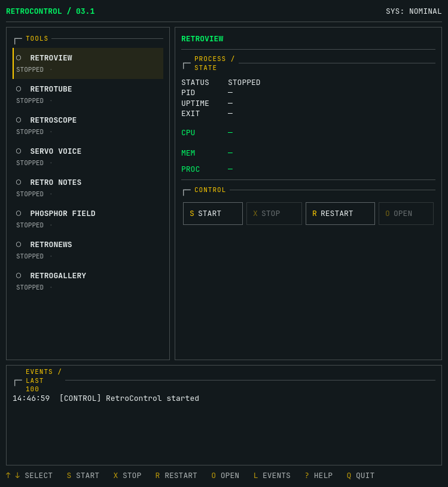

# RetroControl

[Deutsch](README.md) · English

RetroControl is a keyboard-driven launcher and process monitor for Linux. Register the applications you use, start or stop them from one window, and check their uptime, CPU use and memory use. Each application also runs independently.



**The RetroTools in the screenshot are examples.** The download contains RetroControl and one editable registry entry called **My Editor**. You supply the applications.

## Install and run

You need Linux with a readable `/proc` filesystem and Python 3.11 or later. The graphical interface also needs a desktop session, GTK 4, PyGObject, Pycairo and the GI Cairo bridge. On Arch Linux the runtime packages are `python`, `gtk4`, `python-gobject` and `python-cairo`.

Extract the archive, open a terminal in the extracted RetroControl directory and run:

```sh
./bin/rctl --status
./bin/rctl
```

The first command prints process status as JSON. The second opens the window. To add the launcher to your personal bin directory, run `python3 install.py`. It creates a relative symlink at `~/.local/bin/rctl`. Keep the project directory in place. To uninstall the launcher, remove that symlink.

## Add your own applications

Open `registry.json` next to `install.py`. The example expects an executable at `~/Applications/my-editor/my-editor`. Replace the example values with your application's details. For each additional application, add another entry to the `tools` array.

| Field | What to enter |
| --- | --- |
| `id` | A unique identifier using letters, digits, underscores or hyphens. |
| `name` | The name to display in the launcher. |
| `path` | The application's working directory. Relative paths are resolved from the registry file's directory. |
| `launch` | The executable and its arguments as separate JSON strings, such as `["./my-editor", "--new-window"]`. |
| `match` | The program or script name, followed by any argument tokens needed to identify its process. Choose a distinctive match. |

Restart RetroControl to load your changes. To keep a separate registry, start it with `./bin/rctl --registry FILE`. The window opens even if an application's directory is missing. Trying to start that entry displays the error in the detail pane.

Use **↑/↓** to select an application, **S** to start, **X** to stop and **R** to restart. **?** opens keyboard help. **Q** closes RetroControl and leaves running applications active. The default stop action sends SIGTERM to a single process. When several instances match, stop them individually outside RetroControl.

## Local data and security

Load registries you trust. Their commands run with your account's permissions. RetroControl reads process information from Linux `/proc` and works offline. Applications you launch have their own network and data settings.

Process records and size-limited diagnostic logs live in `$XDG_STATE_HOME/retrocontrol`, which defaults to `~/.local/state/retrocontrol`. They can contain local paths and process arguments. Keep credentials out of launch arguments. If you pass `--state-dir`, choose a private directory owned by your account. RetroControl checks ownership, permissions and file types. Other programs running under your account share that account's access.

## Tests and license

Run `python3 -m unittest discover -s tests` from the project directory. The [test report (German)](QA.md) lists the environment and coverage. RetroControl uses the [MIT license](LICENSE). System libraries retain their [respective licenses](THIRD-PARTY.md).
