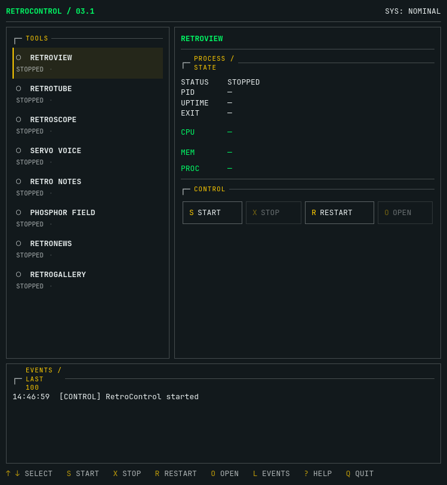

# RetroControl

Eine persönliche Anwendungszentrale für Linux. RetroControl startet und stoppt lokale Programme und zeigt Prozessstatus, Laufzeit, CPU- und Speicherverbrauch. Jede registrierte Anwendung funktioniert auch eigenständig.



**Die dargestellten RetroTools sind Beispiele und nicht Bestandteil des Downloads.** Die mitgelieferte Registry enthält einen einzelnen, anpassbaren Editor-Eintrag.

## Installieren und starten

Linux mit lesbarem `/proc`, Python ab 3.11 und für die Oberfläche eine grafische Sitzung mit GTK 4, PyGObject, Pycairo und der GI-Cairo-Bridge. Auf Arch Linux stellen die Pakete `python gtk4 python-gobject python-cairo` die Laufzeit bereit. Ein Compiler ist für das Quellpaket nicht erforderlich.

Archiv entpacken und im entpackten Verzeichnis ausführen:

```sh
./bin/rctl --status
./bin/rctl
```

Optional legt `python3 install.py` einen relativen Symlink unter `~/.local/bin/rctl` an. Den Projektordner am Installationsort belassen. Zum Deinstallieren den dort angelegten Link entfernen.

## Eigene Anwendungen hinzufügen

`registry.json` neben `install.py` öffnen. Beim Eintrag **My Editor** den Namen, das Arbeitsverzeichnis und das Startprogramm ersetzen. Weitere Einträge in das Array `tools` aufnehmen. Anschließend RetroControl neu starten. Mit `--registry DATEI` lässt sich eine eigene Registry wählen.

| Feld | Bedeutung |
| --- | --- |
| `id` | Eindeutige Kennung aus Buchstaben, Zahlen, Unterstrich oder Bindestrich |
| `name` | Anzeigename |
| `path` | Arbeitsverzeichnis des Programms. Relative Pfade beziehen sich auf den Ort der Registry. |
| `launch` | Programm und Argumente als einzelne JSON-Zeichenketten, z. B. `["./my-editor", "--new-window"]` |
| `match` | Erster Wert bezeichnet das Programm oder Skript, weitere Werte müssen als Argumente zum Prozess passen. Eine eindeutige Kennung wählen. |

Der Beispieleintrag erwartet eine ausführbare Datei unter `~/Applications/my-editor/my-editor`. Auch bei fehlendem Verzeichnis öffnet sich die Oberfläche. Ein Startversuch zeigt den Fehler im Detailbereich.

Mit ↑ und ↓ eine Anwendung wählen, mit **S** starten, mit **X** stoppen und mit **R** neu starten. **?** zeigt die Tastenhilfe. **Q** schließt die Zentrale. Laufende Programme bleiben aktiv. Einzelne Prozesse erhalten beim Stoppen standardmäßig SIGTERM. Bei mehreren erkannten Instanzen ist der gemeinsame Stopp gesperrt.

## Lokale Daten und Sicherheit

Nur eigene oder geprüfte Registrys laden. Ihre Befehle laufen mit den Rechten des angemeldeten Benutzers. RetroControl liest Prozessinformationen aus Linux-`/proc`. Der Controller nutzt lokale Dateien und benötigt keine Netzwerkverbindung. Gestartete Programme haben ihre eigenen Daten- und Netzwerkeinstellungen.

Prozesszuordnungen und begrenzte Diagnoseprotokolle liegen unter `$XDG_STATE_HOME/retrocontrol` (Standard `~/.local/state/retrocontrol`). Sie können lokale Pfade und Prozessargumente enthalten. Zugangsdaten gehören nicht in Startargumente. Für `--state-dir` ein eigenes privates Verzeichnis verwenden. Der Controller prüft Besitz, Rechte und Dateitypen. Programme desselben Benutzerkontos liegen innerhalb derselben Vertrauensgrenze.

## Tests und Lizenz

`python3 -m unittest discover -s tests` führt die Tests im Projektverzeichnis aus. Details zum geprüften System und zu den Grenzen der Prüfung stehen im [Prüfbericht](QA.md). Der Projektcode steht unter der [MIT-Lizenz](LICENSE). Die Systembibliotheken behalten ihre [eigenen Lizenzen](THIRD-PARTY.md).
